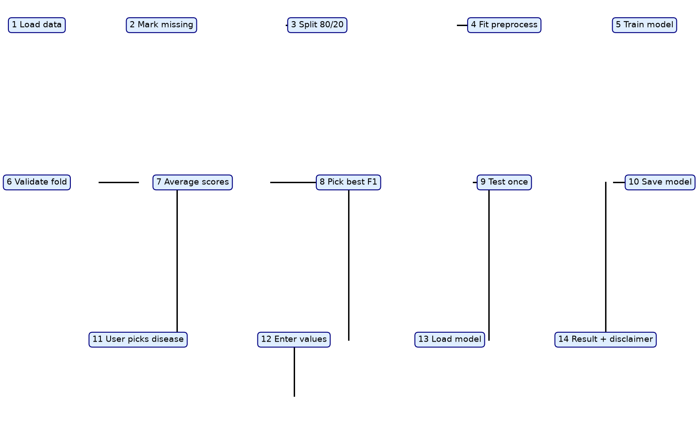
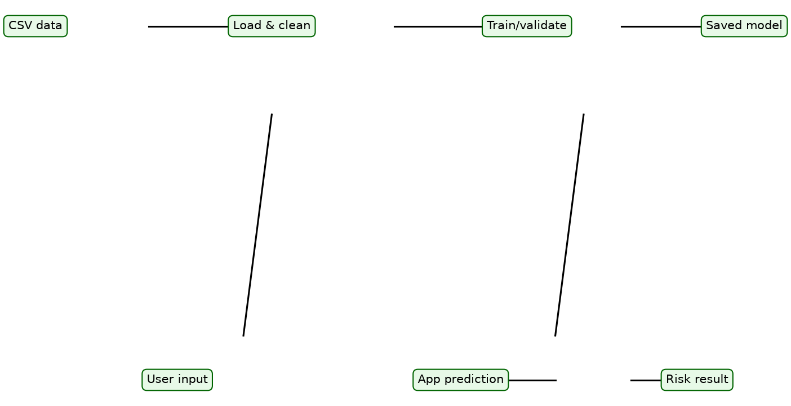
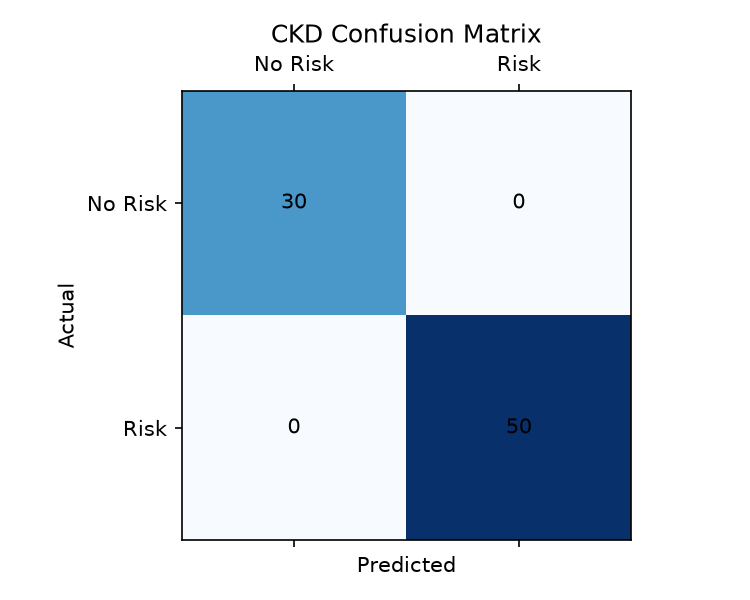
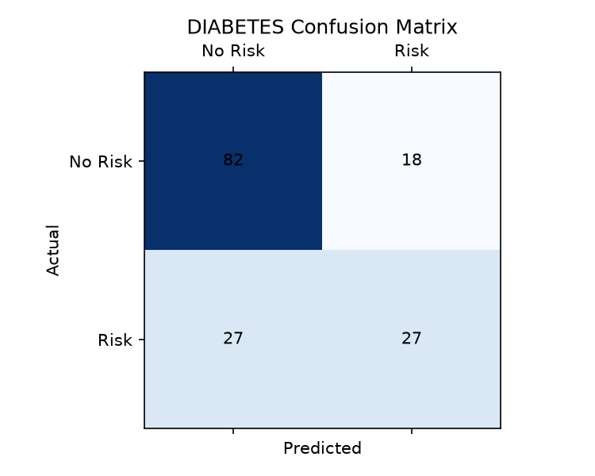
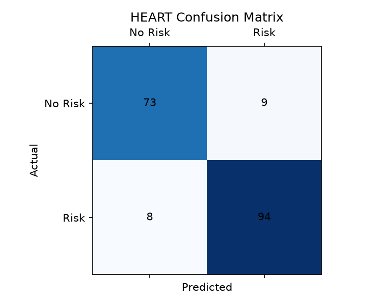
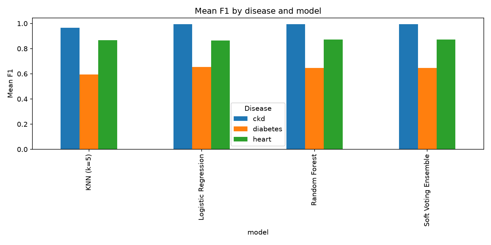

## 1. Title and one-line description

# Multi-Disease Risk Prediction: CKD, Diabetes and Heart Disease Using Machine Learning

This project trains and compares classical machine learning models for three diseases, saves the best model for each, and exposes them through a simple Streamlit app that predicts risk from user-entered clinical values.

## 2. What this project does

This project compares four classical machine learning models for chronic kidney disease, diabetes, and heart disease using public tabular datasets. The workflow is simple and transparent: each dataset is split, preprocessed inside a scikit-learn Pipeline, cross-validated, and evaluated on a held-out test set. The best model for each disease is saved and reused in an app.

The app is designed as a screening aid rather than a diagnosis tool. The user chooses a disease, enters clinical values, and receives a risk/no-risk prediction with a probability and a disclaimer. It is built for academic learning and early screening, not for medical decision-making.

## 3. Why this problem (motivation and SDGs)

Early screening can reduce the burden of chronic disease because treatment starts earlier, complications are fewer, and follow-up care becomes more effective. In low-resource settings, simple tabular models can support a first pass triage step before a clinician reviews the patient.

| SDG | Target | Why it matters here |
|---|---|---|
| SDG 3 Good Health and Well-being | 3.4 and 3.8 | These targets focus on reducing premature mortality and improving access to health screening and essential health services; early detection of CKD, diabetes, and heart disease supports both goals. |
| SDG 9 Industry, Innovation and Infrastructure | 9.5 | This project uses a lightweight, reproducible ML workflow that is suitable for student and small-scale healthcare innovation work. |
| SDG 10 Reduced Inequalities | 10 | This is the weakest fit because the project is a screening aid rather than a policy intervention, but it still supports more accessible early screening for people who may not reach specialist care quickly. |

## 4. Team

| Member | Roll number | Role |
|---|---:|---|
| Swayam Holankar | 5024123 | TBD |
| Shreya Dambe | 5024115 | TBD |
| Dwayne Dcunha | 5024116 | TBD |
| Deena Davis | 5024117 | TBD |

## 5. How it works (system flow)





1. Load the dataset for the selected disease and keep the raw source file separate from the training code.
2. Mark missing values according to the disease-specific rules, including `?`, empty values, and impossible zero values.
3. Split the data once into a stratified 80/20 hold-out with `random_state=42`.
4. Fit preprocessing only on the training folds for each model so the pipeline does not leak information from the test set.
5. Train each classical model in the pipeline on the training split.
6. Score each model on each validation fold using cross-validation.
7. Average the fold scores to get mean accuracy, precision, recall, and F1.
8. Pick the best model by mean F1, while checking recall to see whether a near-tie model is more useful for screening.
9. Test the selected model once on the 20% hold-out set and record the test metrics.
10. Retrain the winning model on all available data and save it with `joblib`.
11. The user picks a disease from the Streamlit sidebar.
12. The user enters clinical values for that disease using the metadata saved with the model.
13. The app loads the matching model and metadata for that disease and prepares one-row input data.
14. The app predicts risk/no risk, shows probability, and adds the screening disclaimer.

## 6. Datasets

### CKD

- Name and publisher: Chronic Kidney Disease dataset, UCI Machine Learning Repository.
- Who collected it and when: creators are L. Rubini, P. Soundarapandian, and P. Eswaran; dataset donated in 2015. The UCI page lists the dataset as created in 2015. See dataset page.
- Population: hospital-based clinical sample from a nearly two-month collection period; the UCI page indicates a hospital population with kidney disease screening data.
- Rows and features: 400 rows, 25 columns before dropping `id` and before applying the loader rules; 24 features + target. Verified by `python src/verify_data.py`.
- Class balance: 248 `ckd`, 152 `notckd`.
- Target and meaning: target column is `class`; `ckd` means chronic kidney disease is present, and `notckd` means it is absent.
- Missing values and treatment: `?` values are treated as missing and numeric columns are coerced using `pd.to_numeric(errors="coerce")`; the loader also drops `id` when present and strips whitespace from strings.
- Why we chose it: public benchmark, tabular, small enough for a student project, widely used in educational ML work, and directly relevant to early screening.
- How we acquired it: `pip install ucimlrepo`, then `fetch_ucirepo(id=336)`. The data were combined into one DataFrame and saved to `data/ckd_raw.csv`; the exact UCI page is https://archive.ics.uci.edu/dataset/336.
- Known limitations: single hospital setting, not necessarily representative of all populations, and missingness is not random.

### Diabetes

- Name and publisher: Pima Indians Diabetes dataset, National Institute of Diabetes and Digestive and Kidney Diseases (NIDDK) / standard benchmark dataset.
- Who collected it and when: the original dataset is associated with the 1988 study by Smith et al. See dataset page. The Pima Indian population is described in the original study and the benchmark documentation.
- Population: women aged 21 years and older of Pima Indian heritage in Arizona.
- Rows and features: 768 rows, 9 columns (8 features + target). Verified by `python src/verify_data.py`.
- Class balance: 500 non-diabetic, 268 diabetic.
- Target and meaning: target column is `Outcome`; value `1` means diabetes is present, `0` means not present.
- Missing values and treatment: values of 0 in `Glucose`, `BloodPressure`, `SkinThickness`, `Insulin`, and `BMI` are treated as missing because they are physiologically impossible. The loader leaves `Pregnancies` and `Outcome` zeros unchanged.
- Why we chose it: standard benchmark, public, tabular, small and non-deep-learning friendly, and very common in educational disease prediction work.
- How we acquired it: the fallback route used in this project was the Brownlee dataset on GitHub: https://raw.githubusercontent.com/jbrownlee/Datasets/master/pima-indians-diabetes.data.csv. The file was saved as `data/diabetes.csv` with the required header.
- Known limitations: it is a narrow population (Pima Indian women from a specific region), so generalisation outside that group is limited.

### Heart

- Name and publisher: Heart Failure Prediction dataset by fedesoriano, Kaggle.
- Who collected it and when: the file was downloaded from the Kaggle dataset page for `fedesoriano/heart-failure-prediction`; the dataset is a merged collection of several UCI heart datasets. See dataset page.
- Population: mixed adult patients from multiple UCI heart disease sources, commonly described as a combined heart-disease clinical benchmark.
- Rows and features: 918 rows, 12 columns (11 features + target). Verified by `python src/verify_data.py`.
- Class balance: 410 no heart disease, 508 heart disease.
- Target and meaning: target column is `HeartDisease`; `1` means heart disease is present.
- Missing values and treatment: zero values in `Cholesterol` and `RestingBP` are treated as missing. Categorical columns remain strings and are handled by one-hot encoding.
- Why we chose it: public benchmark, tabular, moderate size, relevant to screening, and standard for early comparison of clinical models.
- How we acquired it: the file was downloaded from https://www.kaggle.com/datasets/fedesoriano/heart-failure-prediction and saved as `data/heart.csv`.
- Known limitations: the combined data is not from a single population and is often noisy; it is still a benchmark dataset rather than a clinical trial dataset, so it should not be interpreted as a validated diagnostic tool.

| Dataset | Rows | Features | Target | Positive class | Class balance |
|---|---:|---:|---|---|---|
| CKD | 400 | 24 | `class` | `ckd` | 248 ckd / 152 notckd |
| Diabetes | 768 | 8 | `Outcome` | `1` | 268 diabetic / 500 not |
| Heart | 918 | 11 | `HeartDisease` | `1` | 508 heart disease / 410 no heart disease |

## 7. Preprocessing

The preprocessing pipeline is intentionally simple and leakage-safe. Missing values are marked according to disease-specific rules: `?` is treated as missing, impossible zeros are replaced with NaN in selected clinical columns, and whitespace is stripped from string values before any numeric conversion. After that, numeric columns are converted only when their non-null values all parse as numbers, and the data are split into train and test sets before fitting the pipeline.

The pipeline applies median imputation for numeric features and most-frequent imputation for categorical features, then scaling for numeric columns and one-hot encoding for categorical columns. `SelectKBest` is used to keep the most informative features before the final classifier. KNN and logistic regression are especially sensitive to scale, so standardisation is needed to keep them stable and comparable.

Data leakage is a serious issue in medical ML because information from the test set can inflate performance and make a model look better than it truly is. In this project, all preprocessing steps occur inside a scikit-learn `Pipeline`, which means they are fit only on the training data and then applied to validation or test data. The earlier CKD-only demo had a leakage issue; this version fixes that by strictly fitting the preprocessing inside the pipeline.

## 8. Models and why we chose them

| Model | What it is | Why included |
|---|---|---|
| Logistic Regression | Linear classifier with a sigmoid link, suitable for binary classification | Fast, interpretable, and a strong baseline for medical tabular data |
| KNN (k=5) | 5-nearest-neighbours classifier | Good benchmark for local geometry and distance-based decision boundaries |
| Random Forest | Ensemble of decision trees | Handles mixed feature types well and is robust on small clinical datasets |
| Soft Voting Ensemble | Voting classifier combining logistic regression, KNN, and random forest | Combines strengths of individual models and often improves recall/decision stability |

We deliberately skipped deep learning, XGBoost, stacking, and hyperparameter search. This project is small, interpretable, and built for a third-year engineering mini project; the datasets are also small enough that classical models are easier to explain and reproduce.

## 9. Evaluation method

For each disease, the dataset is first split once into an 80% training set and a 20% test set using `train_test_split(..., stratify=y, random_state=42)`. The training part is then evaluated with stratified 5-fold cross-validation, and the model scores are averaged. The model is selected by the highest mean F1, with recall checked as a screening-related safety measure.

The metrics used are accuracy, precision, recall, and F1. Accuracy is the proportion of all predictions that are correct, precision measures how many predicted positives were true positives, recall measures how many actual positives were found, and F1 balances precision and recall. For screening, recall and F1 matter more than accuracy because missing a real positive case can be clinically important.

The winning model is the one with the highest mean F1. If another model has recall higher by more than 0.03 and F1 within 0.02 of the best model, that is noted as a screening-relevant trade-off, but the rule for selection remains simple and defensible.

## 10. Results

### Cross-validation results

#### CKD

| Model | Accuracy mean ± std | Precision mean ± std | Recall mean ± std | F1 mean ± std |
|---|---:|---:|---:|---:|
| Random Forest | 0.9969 ± 0.0063 | 0.9950 ± 0.0100 | 1.0000 ± 0.0000 | 0.9975 ± 0.0051 |
| Logistic Regression | 0.9906 ± 0.0125 | 0.9950 ± 0.0100 | 0.9900 ± 0.0200 | 0.9923 ± 0.0102 |
| Soft Voting Ensemble | 0.9844 ± 0.0171 | 0.9947 ± 0.0105 | 0.9797 ± 0.0191 | 0.9871 ± 0.0142 |
| KNN (k=5) | 0.9625 ± 0.0077 | 0.9947 ± 0.0105 | 0.9445 ± 0.0098 | 0.9689 ± 0.0064 |

#### Diabetes

| Model | Accuracy mean ± std | Precision mean ± std | Recall mean ± std | F1 mean ± std |
|---|---:|---:|---:|---:|
| Logistic Regression | 0.7882 ± 0.0191 | 0.7638 ± 0.0598 | 0.5748 ± 0.0227 | 0.6545 ± 0.0244 |
| Soft Voting Ensemble | 0.7768 ± 0.0353 | 0.7289 ± 0.0844 | 0.5889 ± 0.0659 | 0.6473 ± 0.0559 |
| Random Forest | 0.7687 ± 0.0271 | 0.6995 ± 0.0636 | 0.6028 ± 0.0258 | 0.6458 ± 0.0298 |
| KNN (k=5) | 0.7296 ± 0.0407 | 0.6367 ± 0.0894 | 0.5654 ± 0.0558 | 0.5939 ± 0.0469 |

#### Heart

| Model | Accuracy mean ± std | Precision mean ± std | Recall mean ± std | F1 mean ± std |
|---|---:|---:|---:|---:|
| Soft Voting Ensemble | 0.8570 ± 0.0324 | 0.8631 ± 0.0437 | 0.8843 ± 0.0147 | 0.8730 ± 0.0255 |
| Random Forest | 0.8556 ± 0.0298 | 0.8551 ± 0.0433 | 0.8942 ± 0.0413 | 0.8728 ± 0.0242 |
| KNN (k=5) | 0.8474 ± 0.0334 | 0.8466 ± 0.0403 | 0.8867 ± 0.0122 | 0.8659 ± 0.0265 |
| Logistic Regression | 0.8474 ± 0.0299 | 0.8616 ± 0.0457 | 0.8671 ± 0.0222 | 0.8633 ± 0.0226 |

### Test results

| Disease | Winning model | Accuracy | Precision | Recall | F1 |
|---|---|---:|---:|---:|---:|
| CKD | Random Forest | 0.9750 | 0.9615 | 1.0000 | 0.9804 |
| Diabetes | Logistic Regression | 0.7078 | 0.6000 | 0.5000 | 0.5455 |
| Heart | Soft Voting Ensemble | 0.9076 | 0.9126 | 0.9216 | 0.9171 |

The strongest result was for CKD, where the Random Forest model achieved near-perfect performance on the held-out test data. Diabetes was the hardest task, and the result was the lowest F1 overall, which is a realistic signal that the disease is harder to separate in this benchmark. The heart disease model performed well and was slightly better than the random forest in the held-out test set. The comparison chart below highlights that the best model differs across diseases, which is why we trained and selected each one separately.









## 11. How to run

### Setup

```bash
git clone <repo-url>
cd MULTI-DISEASE-RISK-PREDICTION
python -m venv .venv
source .venv/bin/activate
pip install -r requirements.txt
```

### Data download

```bash
python - <<'PY'
from ucimlrepo import fetch_ucirepo
import pandas as pd
import os

os.makedirs('data', exist_ok=True)
obj = fetch_ucirepo(id=336)
df = obj.data.original.copy()
for c in df.columns:
    if df[c].dtype == object:
        df[c] = df[c].astype(str).str.strip()
df.to_csv('data/ckd_raw.csv', index=False)

url = 'https://raw.githubusercontent.com/jbrownlee/Datasets/master/pima-indians-diabetes.data.csv'
df2 = pd.read_csv(url, header=None)
df2.columns = ['Pregnancies', 'Glucose', 'BloodPressure', 'SkinThickness', 'Insulin', 'BMI', 'DiabetesPedigreeFunction', 'Age', 'Outcome']
df2.to_csv('data/diabetes.csv', index=False)
PY
```

Place the Kaggle heart dataset in `data/heart.csv` before running the project.

### Run order

```bash
python src/verify_data.py
python src/train.py
streamlit run app/app.py --server.headless true
```

## 12. Project structure

```text
multi-disease-risk-prediction/
├── app/
│   └── app.py
├── data/
│   ├── README_DATA.md
│   ├── ckd_raw.csv
│   ├── diabetes.csv
│   └── heart.csv
├── docs/
│   ├── architecture.png
│   └── flow_diagram.png
├── models/
│   ├── ckd_meta.json
│   ├── ckd_model.pkl
│   ├── diabetes_meta.json
│   ├── diabetes_model.pkl
│   ├── heart_meta.json
│   └── heart_model.pkl
├── notebooks/
│   └── demo.ipynb
├── results/
│   ├── comparison.png
│   ├── confusion_ckd.png
│   ├── confusion_diabetes.png
│   ├── confusion_heart.png
│   ├── cv_results_ckd.csv
│   ├── cv_results_diabetes.csv
│   ├── cv_results_heart.csv
│   ├── data_verification.txt
│   └── test_results.csv
├── src/
│   ├── __init__.py
│   ├── config.py
│   ├── data_loader.py
│   ├── evaluate.py
│   ├── models.py
│   ├── pipeline.py
│   ├── train.py
│   └── verify_data.py
├── .gitignore
├── README.md
├── requirements.txt
└── .git
```

## 13. Interface and constants

The project uses the following shared constants:

- `RANDOM_STATE = 42`
- `N_FOLDS = 5`
- `TEST_SIZE = 0.20`
- `KNN_K = 5`
- `RF_TREES = 300`
- `LOGREG_MAX_ITER = 1000`

The dataset configuration is stored in `DATASETS` and contains each disease path, target column, positive label, missing-value rules, and display label.

Core function signatures:

- `load_dataset(name) -> (X, y)` in `src/data_loader.py`
- `build_pipeline(X, model, k="all") -> sklearn.pipeline.Pipeline` in `src/pipeline.py`
- `get_models() -> dict[str, estimator]` in `src/models.py`
- `train_for_disease(disease_name)` in `src/train.py`
- `plot_confusion(model, X_test, y_test, disease, title)` and `plot_comparison(results_dir="results")` in `src/evaluate.py`

## 14. Git workflow

```bash
git pull --ff-only origin build-v1
git status
git add .
git commit -m "short change summary"
git push -u origin build-v1
```

We worked on the `build-v1` branch and did not push to `main`.

## 15. Tech stack

| Tool | Purpose |
|---|---|
| Python | Main project language |
| pandas | Data loading, cleaning, tabular work |
| NumPy | Numeric operations |
| scikit-learn | Preprocessing, classifiers, cross-validation, metrics |
| joblib | Save and reload trained models |
| matplotlib | Confusion matrices and comparison chart |
| Streamlit | Web interface for user input and prediction |

## 16. Key concepts

- Stratified split: train/test split that keeps the class distribution similar across both sets.
- Cross-validation: repeated fold-based training and validation to estimate model quality without using the test set too early.
- Data leakage: using information from the test set before evaluation and therefore inflating model performance.
- Imputation: filling missing values with a statistic such as the median or the most frequent category.
- Standardisation: scaling numeric features so models like KNN and logistic regression behave consistently.
- One-hot encoding: converting categorical values into binary indicator columns.
- Feature selection: reducing dimensionality using the `SelectKBest` filter.
- KNN: a distance-based classifier that uses nearby samples to decide the class.
- Random Forest: an ensemble of decision trees that reduces variance and handles mixed data well.
- Soft voting: combining probabilistic predictions from multiple classifiers.
- Precision: of the predicted positives, how many were truly positive.
- Recall: of the actual positives, how many were correctly identified.
- F1: harmonic mean of precision and recall.
- Confusion matrix: table showing true positives, true negatives, false positives, and false negatives.

## 17. Limitations (be honest)

The datasets are small by modern ML standards and therefore results may not generalise to broader populations. The Pima dataset is limited to a specific group of women from Arizona, and the CKD data come from a hospital setting in India. The heart dataset is a combined benchmark from several UCI sources, which is useful for teaching but not a single clinical population. There is no external validation cohort, no clinical ground-truth comparison, and the app is not a medical device or diagnostic system. The results should be read as supporting academic screening experiments rather than patient-level clinical advice.

## 18. Future scope

- Use larger and more diverse datasets from multiple centres.
- Add external validation on unseen hospital or community data.
- Extend the same pipeline to more diseases and richer patient features.
- Improve explainability through SHAP or feature importance analysis.
- Move from a static app to a more robust healthcare dashboard with clinician review workflow.

## 19. Viva cheat sheet

1. Why these three diseases? They are clinically important, common in screening workflows, and have well-known public benchmark tabular datasets.
2. Where did the data come from? CKD came from the UCI repository using `ucimlrepo`, diabetes from the Brownlee Pima dataset, and heart disease from the Kaggle dataset page.
3. What is data leakage and how did you avoid it? Leakage can happen when preprocessing is fitted on the full dataset; here all preprocessing is done inside a Pipeline fit only on training data.
4. Why not deep learning? These datasets are small, classical models are easier to explain, and the project scope forbids deep learning and large search spaces.
5. Why F1 instead of accuracy? Accuracy can look good even when the positive class is missed; F1 balances precision and recall and is better for screening tasks.
6. Why did you keep the split at 80/20? It is a standard, simple benchmark split that keeps enough data for training while creating a clean held-out evaluation set.
7. How does the app work? It loads the saved model and metadata, builds one-row input from the user fields, calls `predict_proba`, and shows the risk/no-risk label.
8. Why are categorical variables one-hot encoded? Most classifiers need numerical input, and this converts categories into a binary matrix without imposing an arbitrary ordinal scale.
9. Why is scaling important? KNN and logistic regression are sensitive to feature scale, so scaling prevents dominating features from distorting the decision boundary.
10. Which model won overall? CKD used Random Forest, diabetes used Logistic Regression, and heart disease used the Soft Voting Ensemble in the held-out test set.
11. What are the limitations of the project? The data are small and non-clinical; they are not a substitute for actual patient diagnosis.
12. Are you claiming this is a diagnosis tool? No. It is a screening aid built for an academic project, and the disclaimer is included in the app and README.

## 20. Not verified

No required verification step was left unrun. All data checks, model trainings, model reloads, and app start checks were executed successfully in this repo using the commands shown above.

## 21. References

- Mahajan et al., "Ensemble Learning for Disease Prediction: A Review", Healthcare, 2023, 11(12):1808.
- Smith et al., "Using the ADAP Learning Algorithm to Forecast the Onset of Diabetes Mellitus", Proc. Symp. on Computer Applications and Medical Care, 1988 (Pima Indians Diabetes dataset).
- Detrano et al., "International application of a new probability algorithm for the diagnosis of coronary artery disease", American Journal of Cardiology, 1989 (UCI Heart Disease).
- UCI Machine Learning Repository, Chronic Kidney Disease dataset (donated 2015), https://archive.ics.uci.edu/dataset/336
- fedesoriano, "Heart Failure Prediction Dataset", Kaggle.
- Pedregosa et al., "Scikit-learn: Machine Learning in Python", JMLR, 2011.
